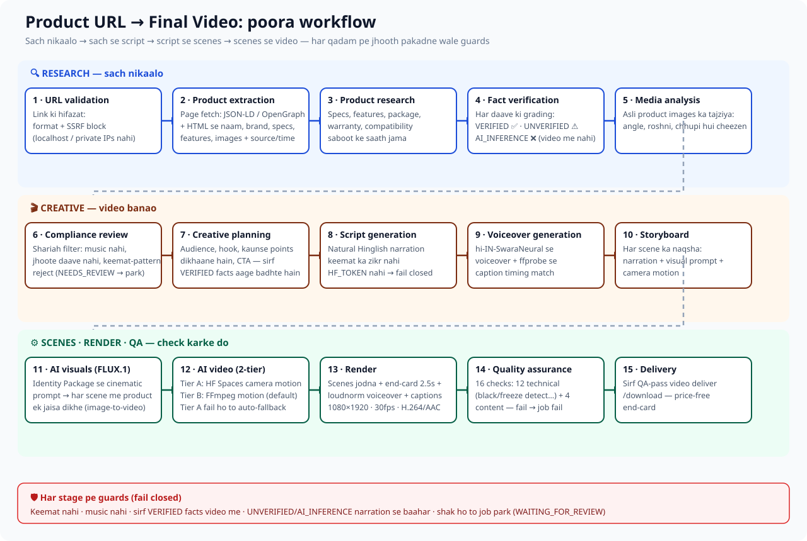

# Product URL → Final Video: Poora Workflow

## Ek jumle me

URL se **sach** nikalta hai, sach se **script** banti hai, script se **scenes** bante hain,
scenes se **video** — aur har qadam pe jhooth pakadne wale guards lage hain.

## Stage mapping (code se)

| Diagram | Stage key (`src/lib/job-stages.ts`) | Output |
|---|---|---|
| 1 · URL validation | `url_validation` | Sanitized URL; SSRF (localhost/private IPs) blocked |
| 2 · Product extraction | `product_extraction` | ProductResearchObject (`src/lib/research.ts`): naam, brand, specs, features, images + source URL & time |
| 3 · Product research | `product_research` | Enriched specs/features/warranty/compatibility |
| 4 · Fact verification | `fact_verification` | Har claim graded: `verified` / `unverified` / `ai_inference` |
| 5 · Media analysis | `media_analysis` | MediaAnalysisObject: angle, roshni, obstructions, embedded claims |
| 6 · Compliance review | `compliance_review` | Shariah filter; `NEEDS_REVIEW` → job park (`WAITING_FOR_REVIEW`) |
| 7 · Creative planning | `creative_planning` | Audience, hook, CTA — sirf VERIFIED facts |
| 8 · Script generation | `script_generation` | Hinglish narration, price-pattern rejection; fails closed without HF_TOKEN |
| 9 · Voiceover generation | `voiceover_generation` | hi-IN-SwaraNeural; ffprobe se duration adjust |
| 10 · Storyboard | `storyboard_generation` | Scene plan: narration + visual prompt + camera motion |
| 11 · AI visuals | `ai_visual_generation` | FLUX.1 images, ProductIdentityObject se visual consistency |
| 12 · AI video | `ai_video_generation` | Tier A (HF Spaces, experimental) → auto-fallback Tier B (FFmpeg motion) |
| 13 · Render | `editing_rendering` | 1080×1920 @30fps, end-card 2.5s, loudnorm, burned-in captions |
| 14 · Quality assurance | `quality_assurance` | 16 checks (12 technical + 4 content); FAIL → job fails |
| 15 · Delivery | `final_delivery` | Sirf QA-pass video, `/download` |

## Guards (fail closed)

- Keemat video me kabhi nahi — price-pattern milte hi reject
- Music bilkul nahi (voiceover + silence only)
- Sirf `verified` facts narration me; `unverified`/`ai_inference` kabhi video me nahi
- Shak ho to job park hota hai, ghalat video render nahi hoti
